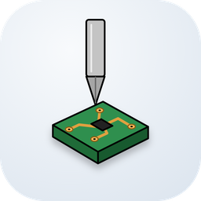
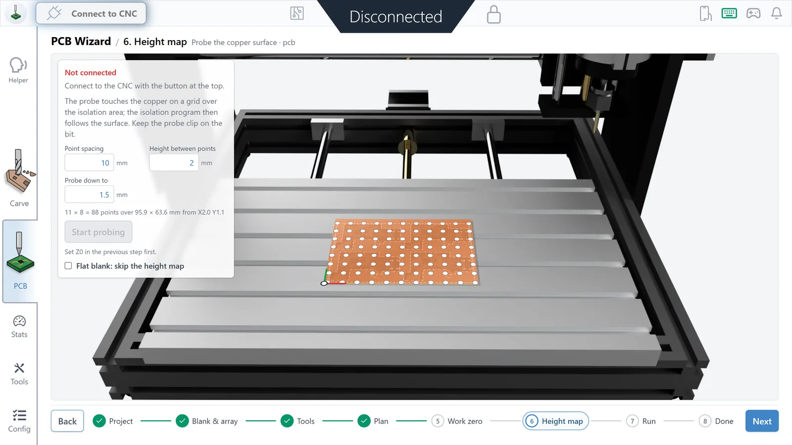
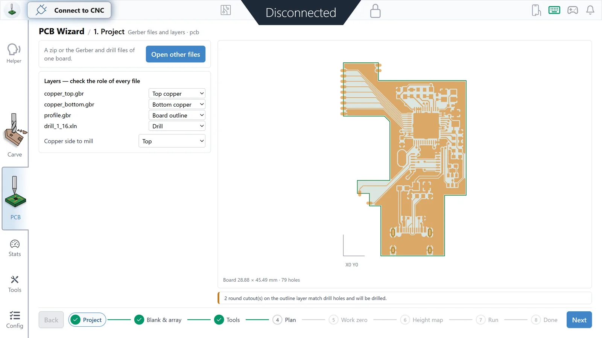
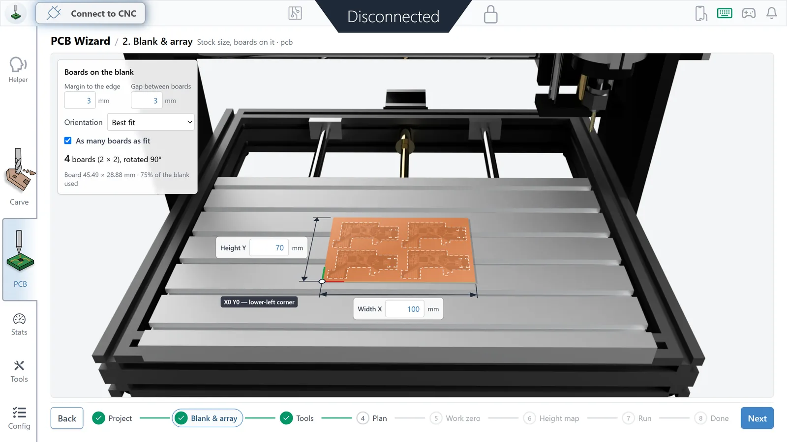
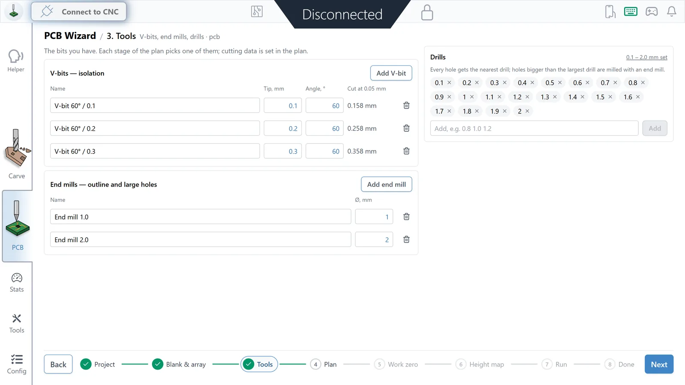
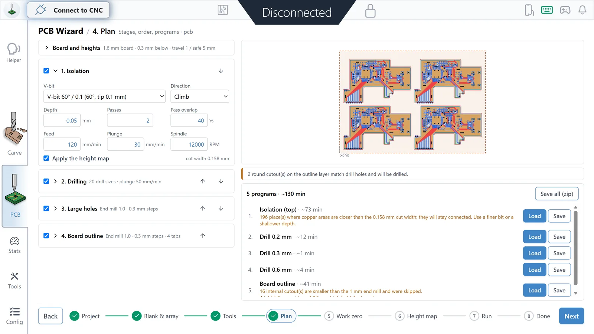
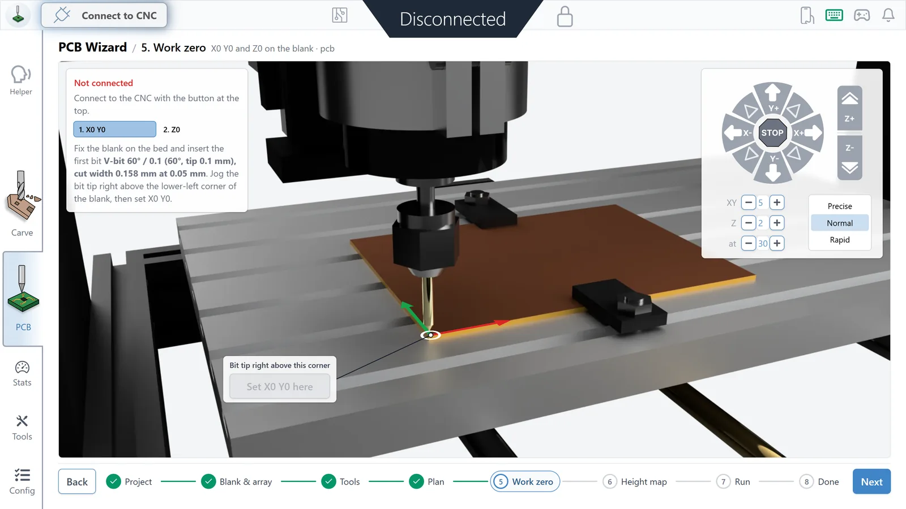
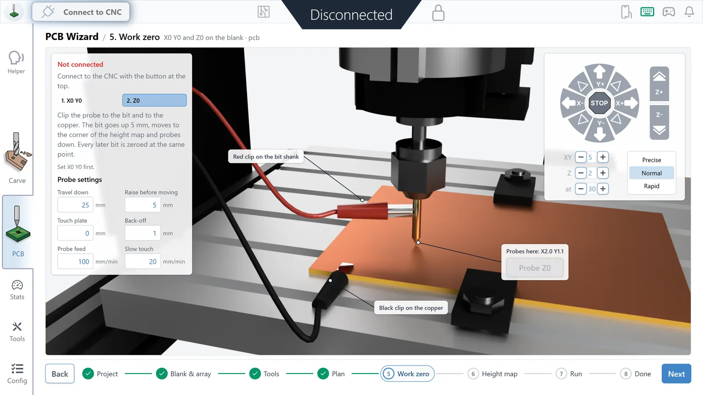
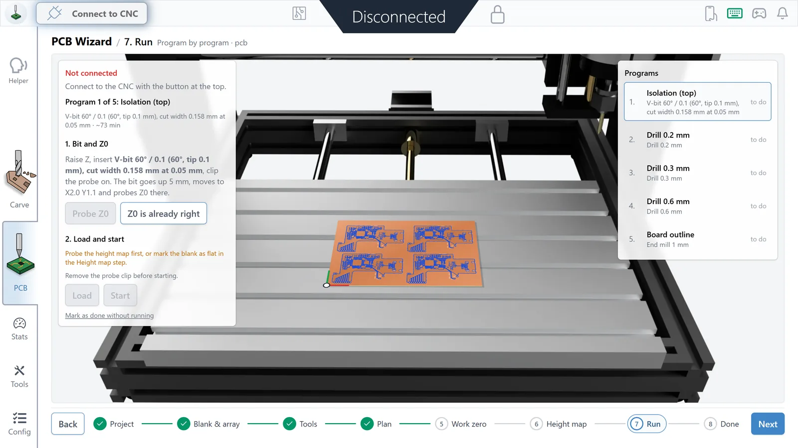

<p align="center">
  
</p>

<h1 align="center">G-PCB</h1>

<p align="center">
  <b>Mill printed circuit boards on a GRBL CNC, step by step.</b><br>
  Gerber files in, finished boards out: board arrays, isolation, drilling, outline with tabs,<br>
  a probed height map and guided bit changes, all in one place.
</p>

<p align="center">
  <a href="https://github.com/ToxaToxaToxa/G-PCB/releases/latest"><b>⬇ Download for Windows</b></a>
  ·
  <a href="https://g-pcb.com">g-pcb.com</a>
  ·
  <a href="#building">Build from source</a>
  ·
  <a href="#version-notes">What's new</a>
</p>



## Why

Milling a PCB on a hobby CNC usually means juggling several programs: one to turn Gerbers into G-code, another to probe the copper, a sender to run it, and a notebook to remember which bit comes next and where Z0 was. G-PCB puts the whole job into one guided workflow inside the CNC sender itself, so the machine, the probe and the programs work from the same zero.

## The PCB wizard

**PCB** sits in the main menu next to Carve. The steps run along the bottom of the screen; any finished step can be opened again. The machine steps are drawn as scenes on a rendered CNC 3018: the blank, the probe points and the toolpaths lie on the bed at true scale, and the settings sit next to them.

| | |
|---|---|
| **1. Project** — open a zip or the Gerber and drill files from Fusion 360 / EAGLE, KiCad, EasyEDA and others, and check the role of every layer. A frame drawn around the board (EAGLE's default 160 × 100 mm board, for example) is recognised. |  |
| **2. Blank & array** — the copper clad blank lies on the machine bed with your boards on it; its width and height are entered right on the dimension lines. G-PCB places as many copies as fit, rotating the board when more fit that way, or the array you ask for. Work zero is the lower-left corner of the blank. |  |
| **3. Tools** — your V-bits with the cut width at the chosen depth, end mills, and the drills you own. |  |
| **4. Plan** — isolation, drilling, large holes and the board outline with tabs. Choose the order, the bit and the cutting data of every stage; each program covers all boards on the blank. Warnings show places a bit cannot isolate. Programs can be loaded, saved, or downloaded together as a zip. |  |
| **5. Work zero** — jog the bit to the blank corner and set X0 Y0, then clip the probe to the bit and the copper and probe Z0 at a fixed reference point. Both are shown as close-ups of the machine. |   |
| **6. Height map** — the probe touches the copper on a grid over the isolation area; the points take colour as they are probed, and the isolation program then follows the real surface of the blank. If probing stops, the reason (alarm, error, no contact, no answer from the controller) is explained with the button that fixes it. |  |
| **7. Run** — program by program: G-PCB asks for the next bit, raises Z, probes Z0 again at the same reference point (so the height map stays valid), loads the program and starts it on your click. The toolpaths are drawn on the blank. Programs started from the Carve screen are tracked too. |  |
| **8. Done** — a summary, or the same boards again on a new blank. | |

The machine never moves on its own: every probe, every start is a button you press, and the start stays disabled until the machine is idle and Z0 is set for the bit in the spindle.

### Also in Tools

- **PCB Milling** — the same toolpath engine on one page, for a single board.
- **Height Map** — probe a height map and apply it to any loaded G-code.

### Current limits

- Single-sided boards (top or bottom copper, mirrored for the bottom).
- Windows installer only; the code builds for macOS and Linux like gSender, but those builds are untested.

## Install

Download `G-PCB-<version>-x64.exe` from the [latest release](https://github.com/ToxaToxaToxa/G-PCB/releases/latest) and run it. The installer is not code-signed, so Windows SmartScreen may warn: choose *More info → Run anyway*.

G-PCB installs next to gSender, not over it: it has its own application id and keeps its settings in `%APPDATA%\G-PCB`. It checks this repository for updates on start and offers them; nothing is downloaded without asking. *Stats → About → Check for updates* checks on demand.

## Test board

[samples/test-board-50x50](samples/test-board-50x50) is a 50 × 50 mm test board for a first run on a new machine or bit: a trace width row from 0.15 to 1.0 mm, clearance pairs from 0.15 to 0.4 mm, SOIC-8, TSSOP-14 at 0.65 mm pitch, 1206–0402 chip pads, DIP-8, a pin header, arcs, text, a copper pour, vias, mounting holes and a rounded outline. Mill it once and you know the finest trace and gap your machine, bit and depth can do. Download [gpcb-test-50x50.zip](samples/test-board-50x50/gpcb-test-50x50.zip) and load it in the PCB Wizard.

## Support

- **Questions and problems** — [open an issue](https://github.com/ToxaToxaToxa/G-PCB/issues) or write on [WhatsApp](https://wa.me/380956652468?text=G-PCB%3A%20) (also in *Stats → About*, with your version filled in).
- **Donate** — G-PCB is free; if it saved you a trip to a board house, you can support it through the [Monobank jar](https://send.monobank.ua/jar/9wXzwVuoo3).
- **Website** — [g-pcb.com](https://g-pcb.com), in English and Ukrainian.

## Building

Requires Node.js 24 and Yarn 1, on Windows with Git Bash.

```sh
yarn install
npm run package-sync
yarn --cwd src install --production --ignore-scripts --non-interactive
yarn run build-latest
yarn run build:windows        # installer in output/
```

A release build keeps the plain version number the updater expects:

```sh
npm run prebuild-prod
yarn run build
yarn run build:windows        # G-PCB-<version>-x64.exe, .blockmap and latest.yml
```

Attach those three files to a GitHub release tagged `v<version>`. The `version` in `package.json` is the G-PCB version; `gsenderVersion` is the gSender release G-PCB is based on and drives the settings migrations.

### Updating from gSender

G-PCB keeps gSender's full history, so new gSender releases merge in like any other branch:

```sh
git remote add upstream https://github.com/Sienci-Labs/gsender.git
git config remote.upstream.tagOpt --no-tags   # gSender's old v1.0.x tags would clash with G-PCB's
git fetch upstream
git merge upstream/master                     # or the commit of a gSender release
```

Conflicts can only come from places G-PCB changed: branding (`package.json`, `src/main.js`, icons, splash), telemetry setup, the navigation and routes, and the README. Afterwards set `gsenderVersion` in `package.json` to the merged gSender release, run the tests, and release a new G-PCB version.

The PCB code lives in `src/app/src/features/PcbWizard`, `PcbMilling` and `HeightMap`; tests run with `node_modules/.bin/jest --config jest.config.js --testPathPatterns="PcbWizard|PcbMilling|HeightMap"`.

## Privacy

Crash reports and failed height map runs go to the G-PCB Sentry project without personal data. Usage statistics are off. Builds made from this repository send nothing unless you put your own keys in `.env` (see `.env.example`).

## Credits and license

G-PCB is built on [gSender](https://github.com/Sienci-Labs/gsender) by Sienci Labs — the CNC sender, visualizer, jogging, probing and everything else outside the PCB features comes from there. G-PCB is an independent project, not made, endorsed or supported by Sienci Labs. The original gSender README is kept in [docs/gsender-README.md](docs/gsender-README.md).

The test boards come from [pcsx-redux](https://github.com/grumpycoders/pcsx-redux/tree/main/hardware) (GPL-2.0) and the [Modxo RP2040 Zero adapter](https://github.com/m4x10187/Modxo_RP2040_Zero_Adapter) (CERN-OHL-P-2.0).

G-PCB is free software under the [GNU General Public License v3](LICENSE), like gSender.

## Version notes

<details>
<summary>Expand to see all version notes</summary>

### 1.0.15 (November 22, 2026)
- PCB Wizard: the project is now really kept after closing G-PCB. In 1.0.14 it was saved in the window's own storage, which the desktop app starts empty every time; it is now a file in the app data folder
- PCB Wizard: on the Run step, *Start* stays locked until the red *I removed the probe clip* button is pressed; it is asked again after every Z0 probing

### 1.0.14 (November 22, 2026)
- Height map: a new map is no longer damaged on save when the previous map had more points per row; such a map was dropped on the next start as "not saved"
- Height map: maps damaged this way are repaired on load, so they appear again
- Deleted height maps, tools and drills no longer come back after a restart
- PCB Wizard: the open project is kept when G-PCB is closed; on the next start the wizard offers to continue it. The work zero and Z0 are kept only if the machine reports the same position as before, otherwise they are set again (switch: *Keep the project after closing G-PCB*)
- PCB Wizard: *What to make* at the top of the plan — isolation, drilling, large holes, outline — with the number of programs and the time; a new project starts with all of them
- PCB Wizard: *Skip* a program on the Run step; skipped programs are shown apart from the finished ones

### 1.0.13 (November 22, 2026)
- Test board 50 × 50 mm in samples/test-board-50x50 (also on g-pcb.com) to check the finest trace and clearance your machine can mill
- Height map: no false "outside the probed area" warning for the rapid return to X0 Y0 at the end of a program; only cutting moves are checked

### 1.0.12 (November 22, 2026)
- Height map: the map is kept when the controller does not report the last touch; once every point is touched and the machine is idle, probing finishes
- Height map: after Stop or an error the measured points stay on screen, in the wizard too
- Height map: probing is logged (start, ignored reports, why it finished) and a failed run is reported, so problems can be found

### 1.0.11 (November 22, 2026)
- WhatsApp support and Donate buttons in Stats → About
- Links to GitHub and other sites open in your browser again instead of a bare G-PCB window

### 1.0.10 (November 22, 2026)
- The machine steps are scenes: a rendered CNC 3018 fills the step and the settings sit on it
- Blank & array: the blank lies on the bed at true scale with your boards on it; its width and height are entered right on the dimension lines
- Work zero: close-ups of the bit over the blank corner (X0 Y0) and of the probe clips (Z0), with the buttons next to them
- Height map: the probe points lie on the copper and take colour as they are probed
- Run: the current program's toolpaths are drawn on the blank, with the program list beside it

### 1.0.9 (November 22, 2026)
- Rendered pictures of a CNC 3018 on the Blank & array, Work zero, Height map and Run steps show what to do at the machine: the clamped blank, X0 Y0 at the corner, the probe clips for Z0, the height map points and the bit change; a click opens a picture full size

### 1.0.8 (November 22, 2026)
- Check for updates button in Stats → About: answers "up to date" too, and opens the update window at once when a new version is out
- The About page describes G-PCB, with credit to gSender and its team

### 1.0.7 (November 22, 2026)
- Height map probing stops with a clear message when the controller stops answering, instead of waiting forever
- When probing stops on an alarm, the wizard explains the cause (no contact, probe already closed, limits) and offers Unlock or Reset controller
- The wizard stays on the Work zero or Height map step while probing, so the probe results are not lost

### 1.0.6 (November 22, 2026)
- Fixed a crash when closing G-PCB right after the machine was sent commands, for example during height map probing: an aborted write on the closing port no longer closes G-PCB with an error

### 1.0.5 (November 12, 2026)
- Fixed a crash when disconnecting from a machine connected over Ethernet (telnet)
- Fixed a crash when closing G-PCB while connected to a machine: the port is now closed before G-PCB exits

### 1.0.4 (October 6, 2026)
- A window announces new G-PCB versions with their release notes, with Update and Later; it never appears during a job, and updating is blocked until the job ends
- The update page, release notes and GitHub links point to G-PCB instead of gSender

### 1.0.3 (October 6, 2026)
- Fixed a crash when an Ethernet (telnet) connection could not reach the machine, for example ENETUNREACH on 192.168.5.1 with no network cable: the error is now shown instead of closing G-PCB

### 1.0.2 (September 27, 2026)
- Start is allowed only when the loaded file is the program's current G-code, so an isolation program loaded before the height map was probed can no longer run without it
- Z0 is recorded for the bit that was probed, even if another program was selected meanwhile
- Wizard settings (tools, drills, blank, stage order, probe) are kept after a restart
- Height map notes, such as toolpath points outside the probed area, are shown in the Plan and Run steps
- Changing the plan during a job keeps "done" only for unchanged programs and asks for a new height map and Z0 when the isolation area moved
- A fixed board array that does not fit is cut down to the boards that fit, never placed past the blank
- Height map: no invalid X NaN moves in relative (G91) mode after an unreadable arc
- No usage statistics consent dialog while the build has no statistics project

### 1.0.1 (September 27, 2026)
- New G-PCB splash screen and application icon everywhere
- Updates and links point to the renamed ToxaToxaToxa/G-PCB repository
- These notes in the app now describe G-PCB instead of gSender

### 1.0.0 (September 27, 2026)
- First release: PCB section with the eight-step wizard, from Gerber files to finished boards
- Board arrays on a blank with best-fit rotation; frames around a board are recognised
- Isolation, drilling, large hole milling and outline with tabs for all boards on the blank
- Work zero, Z0 probing at a fixed reference point, height map probing, guided bit changes
- Programs started from the Carve screen are tracked by the wizard
- Based on gSender 1.6.4

</details>
