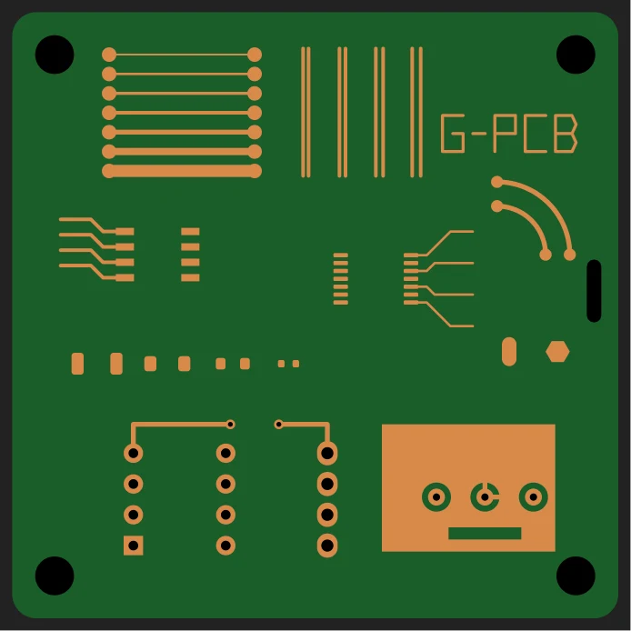
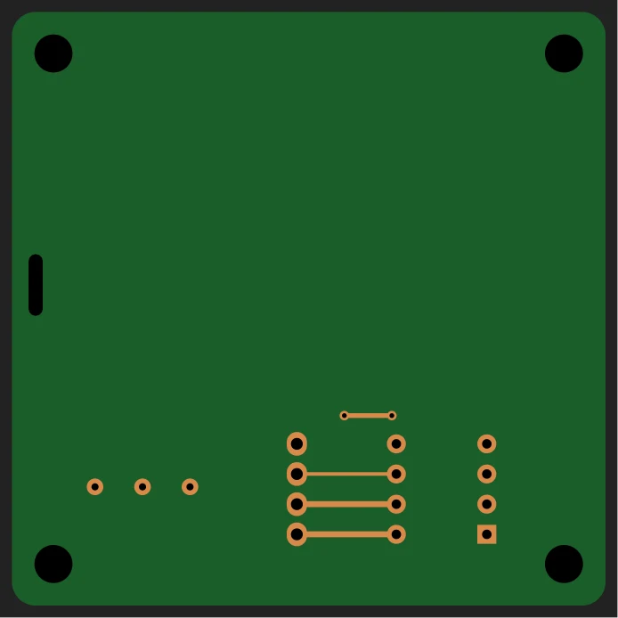

# Test board 50 × 50 mm

A two-layer test board for checking a machine and its settings before milling a real board. Every element tests one part of the job: how fine a trace the V-bit leaves, how narrow a gap it still cuts, whether fine-pitch pads survive, whether holes line up with pads, and how the outline and tabs come out.

Download: [gpcb-test-50x50.zip](gpcb-test-50x50.zip) (load it in the PCB Wizard as is), or the separate files in [gerber/](gerber).

| Top (F_Cu) | Bottom (B_Cu, mirrored as milled) |
|---|---|
|  |  |

## What is on it

| Element | Size | What it checks |
|---|---|---|
| Trace width row | 0.15 / 0.2 / 0.25 / 0.3 / 0.4 / 0.6 / 1.0 mm | The thinnest trace that survives isolation with your bit, depth and height map |
| Clearance pairs | 0.3 mm traces, gaps 0.15 / 0.2 / 0.3 / 0.4 mm | The narrowest gap the V-bit still cuts through. The 0.15 mm gap is narrower than a 60° / 0.1 mm bit cuts at 0.05 mm depth (0.158 mm), so G-PCB reports it, and it stays connected; this is intentional |
| SOIC-8 | pitch 1.27 mm, pads 1.5 × 0.6 mm | A common SMD package, fan-out with 45° bends |
| TSSOP-14 | pitch 0.65 mm, pads 1.2 × 0.35 mm, rounded corners (aperture macro) | Fine-pitch pads: 0.3 mm gaps between pads |
| Chip pads | 1206, 0805, 0603, 0402 | Small SMD pads and their isolation |
| DIP-8 | pitch 2.54 mm, pads 1.6 mm, drill 0.8 mm, square pin 1 | Drill-to-pad registration, through-hole pads on both layers |
| Pin header 1×4 | oval pads 1.7 × 2.0 mm, drill 1.0 mm | Oval (O) apertures, the 1 mm drill |
| Arc traces | R4 and R6 mm, 0.4 mm wide | Gerber arcs (G02/G03) |
| Hexagon and oval pads | 2.0 mm hexagon, 1.2 × 2.4 mm oval | Polygon (P) and oval (O) apertures |
| Text "G-PCB" | 0.25 mm strokes | Fine detail and sharp corners |
| Copper pour | 14.3 × 10.5 mm with clearances and a thermal pad | Regions (G36/G37), clear polarity (LPC) cut-outs, large-area isolation |
| Vias | pad 0.8 mm, drill 0.4 mm | Smallest drill, top-to-bottom connection |
| Mounting holes | 4 × 3.2 mm, non-plated | Holes milled with the end mill |
| Slot | 1.2 × 4 mm, non-plated (G85) | Slot handling: G-PCB drills only its start point and says so |
| Outline | 50 × 50 mm, corners R2 | Outline cut with arcs and holding tabs |

## How to use it

1. Mill the top side first: isolation, drills, holes, outline. Check the trace row and the clearance pairs with a magnifier or a multimeter; they tell you which trace width and clearance to use in your own designs with this bit and depth.
2. The bottom layer is there to try a bottom-side job (mirrored work coordinates). G-PCB mills one side per job; double-sided boards are planned.

## Regenerate

The files are written by [generate.py](generate.py) (Python 3, no dependencies). Change the geometry there and run `python generate.py`; it rewrites `gerber/` and the zip.
